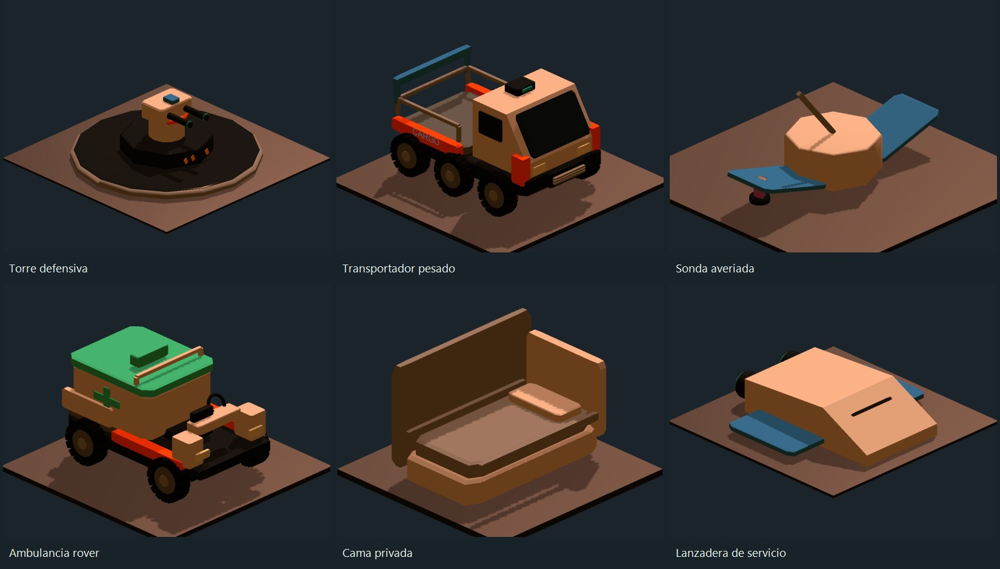

# Mods para Planetbase

Colección para **Planetbase 1.4.2 Steam en Windows x86**. Conserva el nombre del primer mod, `planetbase-resource-menu`, e incorpora la alfa comunitaria **Colonias en expansión**.

## Nueva alfa pública: seis sistemas para tu colonia

**Defensa, logística, expediciones, rescate, vida colonial y comercio**, gestionados desde **F10**. Dieciséis edificios, diez equipos, tres robots fabricables, coche de patrulla, tres recursos y lanzadera comercial de servicio. El paquete conjunto incluye Nuclear y transporte 1.2.0, Frontera Solar 0.3.0 y Ocio colonial 1.2.0 con sus modelos rediseñados.



**[Descargar colección alfa 0.1.0](descargas/Planetbase-ColoniasEnExpansion-0.1.0-alpha.zip?raw=true)** · [Guía completa](mods/PlanetbaseCommunityExpansion/README.md) · [Galería de modelos](docs/ColoniasEnExpansion/GALERIA.md) · [Validación](docs/ColoniasEnExpansion/VALIDACION.md)

Es una versión para pruebas y comentarios. Pasó **567 comprobaciones** en una copia aislada del juego: 270 propias y 297 de regresión de los módulos anteriores con la expansión cargada. No se ha medido el rendimiento en colonias masivas ni el balance de campañas largas. Guarda en una ranura nueva y conserva la anterior.

| Tema | Primera versión implementada |
|---|---|
| Defensa | Radar, torres con energía y repuestos, consola y patrullas de guardias. Incursiones opcionales de Frontera Solar. |
| Logística | Almacenes y rutas con hasta tres cajas físicas; prioridades y fabricación de flota. |
| Expediciones | Señales alcanzables, exploración y regreso con hallazgos; muestras que se convierten en informes. |
| Rescate | Ambulancias que llevan heridos por esclusas al hospital, atención médica nativa y evacuaciones. |
| Vida colonial | Residencias, cafetería y formación pagada que cambia la profesión de un colono. |
| Comercio | Contratos con plazos, depósito y pago único; importaciones con entrega física. |

## Complementos de la colección

| Mod | Versión y descarga | Código y guía |
|---|---|---|
| Menú de recursos | [1.0.0 independiente](descargas/PlanetbaseResourceMenu-1.0.0.zip?raw=true) | [Guía](docs/MenuDeRecursos.md) · [Proyecto](PlanetbaseResourceMenu.csproj) |
| Terreno y velocidad | [1.0.0 independiente](descargas/PlanetbaseTerrainAndSpeed-1.0.0.zip?raw=true) | [Guía y código](mods/PlanetbaseTerrainAndSpeed) |
| Ocio colonial | 1.2.0, incluida en la colección | [Guía y código](mods/PlanetbaseColonyLeisure) |
| Nuclear y transporte | 1.2.0, incluida en la colección | [Guía y código](mods/PlanetbaseNuclearTransport) |
| Frontera Solar | 0.3.0, incluida en la colección | [Guía y código](mods/PlanetbaseSolarFrontier) |
| Colonias en expansión | 0.1.0 alfa, incluida en la colección | [Guía y código](mods/PlanetbaseCommunityExpansion) |

Menú de recursos y Terreno y velocidad son opcionales. La [descarga histórica de Ocio colonial 1.0.0](descargas/PlanetbaseColonyLeisure-1.0.0.zip?raw=true) y la [primera versión del Menú de recursos](https://github.com/Nagisa-Kaw/planetbase-resource-menu/releases/tag/v1.0.0) se conservan. Mantén las DLL 1.2.0 de la colección al probar la alfa.

## Instalar y probar

1. Cierra Planetbase y abre su carpeta desde Steam, **Administrar → Ver archivos locales**.
2. Instala BepInEx 5.4.23.6 para Windows **x86**, o conserva la instalación que ya usas con estos mods.
3. Copia `BepInEx` del ZIP sobre la carpeta del juego, manteniendo una DLL por mod.
4. Inicia Planetbase. Construye una cantina para desbloquear los edificios de la expansión y utiliza **F10**. La flota requiere la investigación de robótica de Frontera Solar.

Las partidas con contenido nuevo necesitan conservar sus mods y dependencias. Las acciones F10 se activan con el icono junto a cada opción. La [guía](mods/PlanetbaseCommunityExpansion/README.md) explica los recursos, tiempos, controles y límites de cada tema. El ZIP incluye fuentes propias y documentación; no incluye el juego, BepInEx, partidas ni complementos QA. Las sumas están en [SHA256SUMS.txt](descargas/SHA256SUMS.txt).

## Enviar comentarios

[Abre un issue](https://github.com/Nagisa-Kaw/planetbase-resource-menu/issues/new/choose) con la versión, complementos instalados, pasos para reproducir y el fragmento relevante de `BepInEx/LogOutput.log`. Son especialmente útiles los problemas de rutas, cargas, rescates, guardado y balance.

## Compilar

Necesitas .NET SDK 8 o posterior y las referencias de tu instalación legítima del juego y BepInEx:

```powershell
$juego='C:\Program Files (x86)\Steam\steamapps\common\Planetbase'
dotnet build mods/PlanetbaseCommunityExpansion/PlanetbaseCommunityExpansion.csproj -c Release "-p:PlanetbaseDir=$juego"
dotnet build mods/PlanetbaseColonyLeisure/PlanetbaseColonyLeisure.csproj -c Release "-p:PlanetbaseDir=$juego"
```

Conserva la carpeta hermana `mods/PlanetbaseVisuals`. También siguen disponibles los proyectos originales de Menú de recursos y Terreno y velocidad. Los complementos `qa` requieren una copia y un perfil preparados y aislados; no se instalan en una campaña habitual.

Proyecto comunitario no oficial. Los destinos de Frontera Solar representan partidas independientes; la colección no simula viajes de colonos entre bases ni reproduce todos los sistemas de Planetbase 2.
